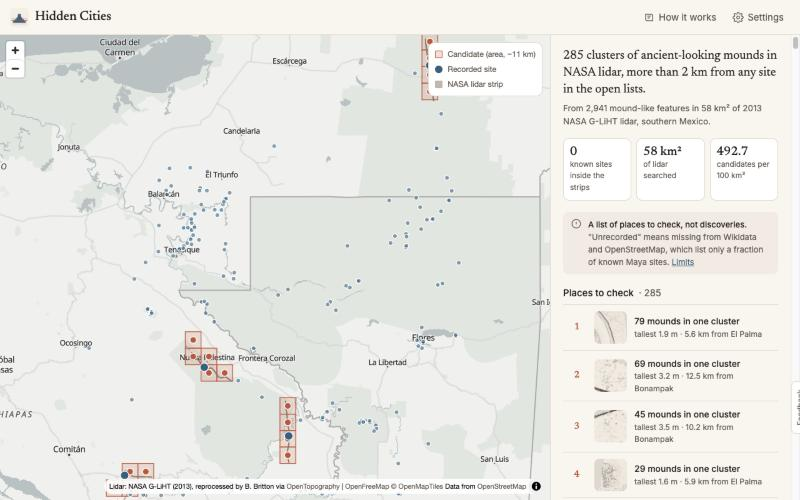

<p align="center"></p>

# Hidden Cities

**Can NASA's forest-carbon lidar point to ancient Maya settlements that no open site list records?** Partly. On a 58 km² test area, a simple, transparent detector finds 2,941 mound-like features. 285 clusters of them lie more than 2 km from any site in Wikidata or OpenStreetMap, and by eye about half of the top 16 look like groups of Maya platforms. The other half are rivers, gullies and hills. But **the open site lists put no recorded site inside the strips**, so the detector can't yet be calibrated against known cities, and the list is a ranked to-check list, not a set of discoveries.

**[Open the map →](https://amalmehta.com/HiddenCities/)** · [How it works](https://amalmehta.com/HiddenCities/method.html) · [Prompt log](docs/PROMPTS.md)



## Question

In 2013 NASA's G-LiHT aircraft flew narrow lidar strips across the Yucatán peninsula to measure forest carbon. Lidar maps the ground under the canopy to about 1 m, and Maya platforms and temples still stand there as low mounds. Archaeologists have already shown that this data holds tens of thousands of structures (Britton et al. 2025; Estrada-Belli et al. 2025), and found a city in it (Valeriana; Auld-Thomas et al. 2024).

This project asks a narrower, open question: **with only public data and a method anyone can rerun, which dense clusters of structures sit far from every site in the open lists?**

## Method

1. **Find mounds.** A white top-hat (the ground minus a 61 m "board" pressed up from below) gives each pixel's local relief. A patch counts as a mound if it stands ≥ 0.5 m proud over 50–2,500 m² and is no more than 5× longer than it is wide. *These thresholds are invented starting values.*
2. **Group them.** DBSCAN links mounds within ε metres into clusters.
3. **Set the city rule from known sites.** A grid search over ε, minimum mound count N and tallest mound H keeps the rules that catch ≥ 90 % of recorded sites inside the lidar, then picks the one with the fewest candidates per 100 km².
4. **Rank and protect.** Clusters more than 2 km from every recorded site are ranked by mound count, then by tallest mound. Unreviewed candidates are published only as a ~11 km grid square, because looters use coordinates.

Equations, with every symbol defined, are on the [method page](https://amalmehta.com/HiddenCities/method.html).

## Results (test area, 2026-11-11)

| | |
|---|---|
| Lidar searched | 20 strip segments, 57.8 km² (NASA G-LiHT 2013, West set) |
| Strip width (measured) | ~390 m |
| Mound-like features | 2,941 |
| Clusters | 317 |
| Recorded sites nearby (Wikidata + OSM, deduplicated) | 164 |
| Recorded sites strictly inside the strip | **0** |
| City rule | **not fitted** — fell back to the loosest rule (ε = 75 m, N = 3, H = 0.5 m) |
| Clusters > 2 km from a recorded site | 285 (493 per 100 km²) |
| Top 16 by eye (non-expert) | ~7 plausible platform groups · ~7 natural (rivers, gullies, hills) · 2 unclear |

**What happened to the calibration.** The test area was chosen as the tiles whose boxes contain a listed site, plus neighbours. The listed points of El Palma, Chinkultic, Nadzca'an and Plan de Ayutla lie 190 m, 240 m, 280 m and 540 m outside the ~390 m strip. Site lists record one point per site, usually near its centre, and these sites probably extend into the strip. But counting them would mean loosening a definition after seeing the result, so we don't. The app shows the strip edge nearest each one, so you can judge by eye.

**What the top candidates look like.** We looked at the pictures of the top 16 twice.

- **The first pass** found a mechanical artifact. The ground is thinly sampled along each strip's edge, which made beaded false "mounds" 30–70 m in from the edge. The detector now ignores a 75 m edge zone (`EDGE_BUFFER_M`, decided after looking and labelled as such). That cut the features from 4,488 to 2,941 and the clusters beyond 2 km from 408 to 285.
- **On the second pass**, about 7 of the 16 show small rectangular platforms in groups, which is what Maya house groups look like. About 7 are natural: a river meander still ranks #1, and winding gullies and hills make the rest. Two are unclear.

This is a plausibility check by one non-expert, not validation. Masking stream channels is the obvious next filter, but we didn't tune further on the same 16 pictures we judged.

**Against the baselines.** Britton, McLellan & Brewer (2025) report a deep-learning detector on this same lidar. Estrada-Belli et al. (2025) model settlement density over ~95,000 km². Neither publishes a ranked list of clusters missing from open gazetteers. Their structure catalogs are not public, so a like-for-like comparison isn't possible yet; emails asking for them are drafted in [docs/outreach/](docs/outreach/).

## Limits

- **"Unrecorded" is weak.** It means "not in Wikidata or OSM", which list only a fraction of the thousands of known Maya sites. Many candidates are surely known to archaeologists.
- **No calibration yet.** With 0 recorded sites inside the strips, the 90 % recall rule couldn't be fitted, so the list has no validated cut-off.
- **Slices, not cities.** A ~390 m strip sees a slice of any settlement.
- **Invented thresholds, no ground truth.** Stream banks, gullies, karst knolls and modern earthworks pass too; about half the top 16 are natural. Nothing has been checked on the ground.

## Next

1. Ground truth inside the strips: Britton's catalog or the Witschey & Brown atlas (requests drafted), or site plans digitised by hand from papers.
2. Mask stream channels (a flow-accumulation filter), then re-audit a fresh sample, not the same 16.
3. Run all 456 transects (~3.7 GB). That needs no code changes, and some listed points may then fall inside.
4. Compare against an ML detector once a public catalog exists.

## Reproduce

```bash
uv sync
uv run pytest -q                       # 18 tests on synthetic terrain
uv run python -m pipeline.run --synthetic   # end to end on a fake area, in seconds
uv run python -m pipeline.run               # real test area: downloads ~170 MB of lidar
python3 -m http.server 8000 --directory site
```

Details: [docs/INSTRUCTIONS.md](docs/INSTRUCTIONS.md) · [docs/SYSTEM-DESIGN.md](docs/SYSTEM-DESIGN.md) (architecture, threat model) · [docs/FILE-STRUCTURE.md](docs/FILE-STRUCTURE.md) · [docs/REVIEW-CHECKLIST.md](docs/REVIEW-CHECKLIST.md) · [docs/PROMPTS.md](docs/PROMPTS.md)

## Data and licences

- Lidar: NASA G-LiHT 2013, reprocessed to bare earth by B. J. Britton, via OpenTopography — [doi:10.5069/G9Z899N1](https://doi.org/10.5069/G9Z899N1), [doi:10.5069/G9TH8JX9](https://doi.org/10.5069/G9TH8JX9) (CC BY 4.0).
- Recorded sites: [Wikidata](https://www.wikidata.org) (CC0) and [OpenStreetMap](https://www.openstreetmap.org) (ODbL), fetched 2026-11-11.
- Basemap: [OpenFreeMap](https://openfreemap.org), © OpenMapTiles, © OpenStreetMap contributors.

## References

- Auld-Thomas, L., Canuto, M. A., et al. (2024). Running out of empty space: environmental lidar and the crowded ancient landscape of Campeche, Mexico. *Antiquity*.
- Britton, B. J., McLellan, A., & Brewer, J. (2025). Evaluating broadscale deep learning for Maya settlement detection in G-LiHT lidar. *Journal of Archaeological Method and Theory* 33:15.
- Canuto, M. A., et al. (2018). Ancient lowland Maya complexity as revealed by airborne laser scanning of northern Guatemala. *Science* 361.
- Estrada-Belli, F., Canuto, M. A., Šprajc, I., & Fernandez-Diaz, J. C. (2025). New regional-scale Classic Maya population density estimates and settlement distribution models through airborne lidar scanning. *Journal of Archaeological Science: Reports*.
