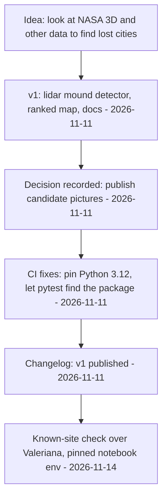
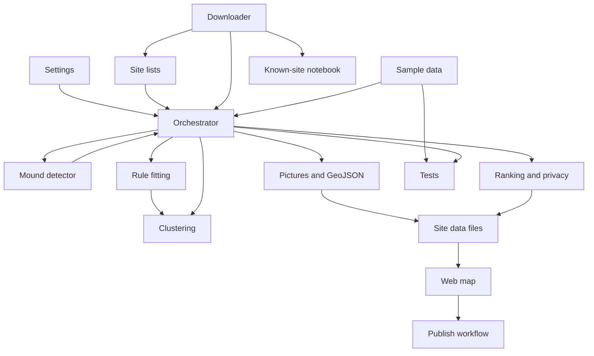
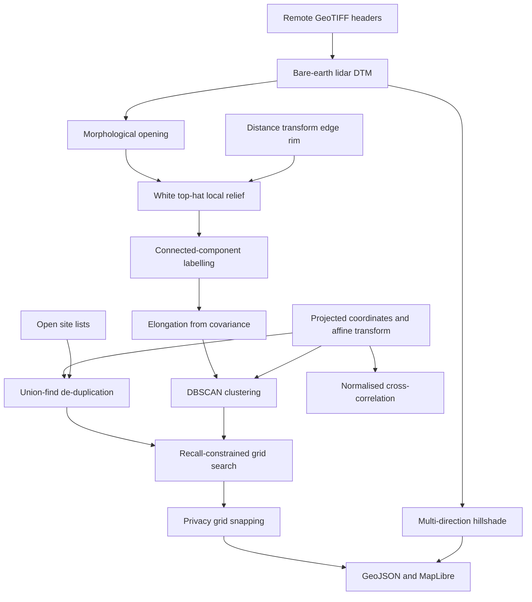

<!-- ProjectForge explainer at ec68076 -->
# How find hidden cities artifacts from nasa + ground data was built

Hidden Cities is a research pipeline and a static website. It searches public NASA airborne lidar over southern Mexico for clusters of small mounds that look like ancient Maya towns but sit more than 2 km from any site in open lists. It is for archaeologists and curious readers who want a short, checkable list of places to look. The one idea that makes it work is that a bare-earth terrain model with the forest removed shows house mounds as small bumps. A "top-hat" filter separates those bumps from hills, and the size of each group of bumps marks a possible town.

## Build history

- **v1 (2026-11-11):** the first commit added the whole pipeline: a lidar mound detector, a ranked map of unrecorded clusters, and the docs.
- **Publish pictures (2026-11-11):** the decision to publish pictures of candidates was written down.
- **CI fixes (2026-11-11):** Python was pinned to 3.12 so the pinned geospatial wheels install in CI, the custom-domain site was linked, and `uv run pytest` was made able to find the `pipeline` package.
- **v1 published (2026-11-11):** the changelog marked v1 as published.
- **Known-site check (2026-11-14):** the environment for an exploration notebook was pinned. The notebook then asked what public data shows over Valeriana, a lidar-found Maya city.

## Code map

| Part | File | What it does |
|---|---|---|
| Settings | `pipeline/config.py` | Holds every tunable number, each labelled INVENTED, FITTED or DECIDED, plus paths and dataset IDs. |
| Downloader | `pipeline/fetch.py` | Lists lidar tiles in OpenTopography's public bucket, reads tile bounds remotely, downloads tiles, and queries Wikidata and OpenStreetMap. Logs each file in `data/manifest.json`. |
| Site lists | `pipeline/gazetteer.py` | Turns Wikidata and OpenStreetMap results into `Site` records and merges entries closer than 500 m. |
| Sample data | `pipeline/synthetic.py` | Builds three fake lidar strips with a known answer: two recorded cities, one unrecorded city, and decoys. |
| Orchestrator | `pipeline/run.py` | Picks the test area, runs detect, calibrate, cluster and rank, then writes every file the site shows. |
| Mound detector | `pipeline/detect.py` | Computes local relief with a white top-hat and keeps mound-shaped blobs. |
| Clustering | `pipeline/cluster.py` | Groups mounds into settlements with DBSCAN. |
| Rule fitting | `pipeline/calibrate.py` | Searches cluster settings for the rule that catches at least 90% of recorded sites with the fewest candidates. |
| Ranking and privacy | `pipeline/rank.py` | Orders candidates, names them, and snaps unreviewed ones to about 11 km grid cells. |
| Pictures and GeoJSON | `pipeline/render.py` | Draws multi-direction hillshade PNGs, with optional mound circles, and writes GeoJSON points. |
| Site data files | `site/data/` | `summary.json`, `candidates.geojson`, `sites.geojson`, `footprint.geojson` and `img/` are the pipeline's output. |
| Web map | `site/app.js`, `site/index.html` | Loads the data files and shows the ranked list, the map (MapLibre) and a detail pane for each place. |
| Publish workflow | `.github/workflows/pages.yml` | Deploys the `site/` folder to GitHub Pages when it changes on `main`. |
| Known-site notebook | `notebooks/known-site-check.ipynb` | Georeferences a published map of Valeriana and compares SRTM, GEDI, Sentinel-2 and lidar coverage over it. |
| Tests | `tests/test_pipeline.py`, `.github/workflows/tests.yml` | Unit tests for each stage plus an end-to-end run on sample data, run in CI with `uv run pytest`. |

## Concepts

**Bare-earth lidar DTM** — Lidar is a laser scanner flown on a plane. Some pulses slip through gaps in the forest and hit the ground. A DTM (digital terrain model) is a grid of ground heights built from those ground hits only, here at 1 m per cell. The project needs it because Maya mounds under 15–25 m of forest show up only once the trees are removed. The notebook's summary records that SRTM, Sentinel-2 and probably GEDI cannot see a known city. The data is NASA G-LiHT 2013, reprocessed by Britton, from OpenTopography (`pipeline/config.py`, `DATASETS`). Tiles are read with rasterio, and no-data values become NaN (`pipeline/run.py`, `load_tile`).

**Remote GeoTIFF headers** — A GeoTIFF is an image file that also stores where on Earth its pixels lie. GDAL's `/vsicurl/` reads just the header bytes of a file over HTTP. The project needs this to learn every tile's bounds without downloading gigabytes, so it can pick only the tiles near recorded sites. `list_keys` pages through the bucket's S3 listing (XML with continuation tokens). `headers` opens each tile through `/vsicurl/` on 16 threads and caches the result (`pipeline/fetch.py`).

**Projected coordinates and affine transform** — Latitude and longitude are angles, so distances in them are not metres. UTM (EPSG:32615 or 32616) is a flat grid in metres. An affine transform maps a pixel's (column, row) to map (x, y) and back. Every distance threshold (75 m clustering, 2 km "unrecorded", 300 m match) assumes metres. `analyse` builds pyproj transformers both ways and uses `tr @ (col, row)` and `~tr @ (x, y)` to move between pixels and the map (`pipeline/run.py`).

**Morphological opening and the white top-hat** — An opening is a minimum filter followed by a maximum filter over a square window. The code's docstring pictures pressing a flat 61 m board up from under the ground: the board cannot follow anything narrower than itself. The top-hat is the ground minus that opening. It is high on small mounds and zero on broad hills and even slopes, which is what a mound detector needs. No-data cells are set very high first, so they cannot drag the minimum down (`pipeline/detect.py`, `local_relief`).

$$\mathrm{LRM}(z) = z - \max_{B}\big(\min_{B}(z)\big),\qquad B = \text{square of side } 61\text{ m}$$

**Distance transform edge rim** — A distance transform gives each valid cell its distance to the nearest no-data cell. Near strip edges the opening is unreliable and the ground is thinly sampled. The config notes that after the first real run this made "beaded false mounds 30–70 m in from the edge". So relief is blanked within max(half a window, 75 m) of no-data (`pipeline/detect.py`; `EDGE_BUFFER_M` in `pipeline/config.py`). The test `test_mounds_near_strip_edge_are_ignored` checks it (`tests/test_pipeline.py`).

**Connected-component labelling and elongation** — Cells with relief of at least 0.5 m are grouped into blobs, with diagonal neighbours counting as touching (`ndimage.label` with a 3×3 structure). Each blob must cover 50–2500 m². Its shape is then measured from the covariance of its pixel coordinates. The ratio of the two eigenvalues says how stretched it is, so roads and ridges (ratio above 5) are dropped (`pipeline/detect.py`, `detect`).

$$e = \sqrt{\lambda_{\max} / \lambda_{\min}}$$

**DBSCAN clustering** — DBSCAN groups points that are linked through neighbours within a distance `eps`. A point with at least `min_samples` neighbours (itself included) is a core point. Points that link to no core point are noise and are dropped. Towns have no fixed shape or count, and DBSCAN needs neither. Each cluster keeps its centre, mound count `n`, tallest mound `max_h` and diagonal extent (`pipeline/cluster.py`).

**Open site lists and union-find de-duplication** — "Recorded" sites come from Wikidata (SPARQL query for items that are an archaeological site, Q839954, or a subclass) and OpenStreetMap (Overpass query for `historic=archaeological_site`) (`pipeline/fetch.py`, `sites_raw`). The same ruin often appears in both, a few hundred metres apart. `dedupe` joins entries within 500 m using union-find. Union-find keeps a parent pointer per item, and following the pointers gives each group's root. A named entry gives the merged site its name (`pipeline/gazetteer.py`).

**Recall-constrained grid search** — Recall is the share of recorded sites inside the lidar that the rule catches. Density is candidates per 100 km² of lidar. `calibrate` tries every eps in {50…200 m}, minimum count N in {3…30} and minimum height H in {0.5…5 m}. Among rules with recall ≥ 0.90 it keeps the one with the lowest density, and ties go to the stricter rule. This replaces made-up thresholds with ones fitted to known sites. If no site lies inside the lidar, it falls back to the loosest rule (eps 75 m, N 3, H 0.5 m) and sets `fallback`. The site then says the list is ranked with no cut-off (`pipeline/calibrate.py`; text in `site/app.js`, `renderList`).

$$\text{rule}^* = \arg\min_{\varepsilon,N,H}\ \frac{100\cdot\#\text{candidates}}{\text{lidar km}^2}\quad\text{s.t.}\quad \frac{\#\text{caught}}{\#\text{eligible}} \ge 0.9$$

**Privacy grid snapping** — Looters use published coordinates. Unreviewed candidates are published at the centre of their 0.1° grid cell (about 11 km), and the cell also names them, e.g. `HC-16.45N90.75W-1`. Exact points go only to `data/private/candidates_exact.json`, which is git-ignored. Only IDs listed in `data/reviews.json` (empty now) get exact points (`pipeline/rank.py`; `PRIVATE` in `pipeline/config.py`). The end-to-end test checks that the exact longitude never appears in the site's data files (`tests/test_pipeline.py`, `test_end_to_end_synthetic`).

**Multi-direction hillshade** — A hillshade shades terrain as if lit by a low sun. One sun direction can hide features that run parallel to it, so `hillshade` averages four azimuths (315°, 45°, 135°, 225°) at 45° altitude with 2× vertical exaggeration. `stretch` then spreads the middle 98% of values so low mounds show (`pipeline/render.py`). Here $a$ is sun altitude, $s$ slope, $\phi$ sun direction and $\alpha$ aspect:

$$I = \tfrac14\sum_{\phi}\big(\sin a\cos s + \cos a\sin s\cos(\phi - \alpha)\big)$$

**GeoJSON and MapLibre** — GeoJSON is JSON for points and shapes in longitude and latitude. MapLibre GL draws them in the browser over free OpenFreeMap tiles. The site is static: `app.js` fetches four files and builds one square polygon per privacy cell (`cellPolys`). It inserts all text with `textContent`, because place names come from editable public lists (`site/app.js`).

**Normalised cross-correlation (notebook only)** — Normalised cross-correlation (NCC) slides a template over an image and scores how well they match at each offset, with brightness and contrast removed. The Valeriana paper prints no coordinates. So the notebook turns the paper's Figure 3 colouring into a slope proxy and correlates it with SRTM slope over an 18 × 18 km area. The best peak places the survey block (NCC 0.416, 6.1 SD above the mean) (`notebooks/known-site-check.ipynb`, section 1).

$$\mathrm{NCC}(u) = \frac{1}{N}\sum_{p}\frac{\big(I(p+u)-\bar I_u\big)\,\hat T(p)}{\sigma_{I,u}},\qquad \hat T = \frac{T-\bar T}{\sigma_T}$$

## One input, start to finish

The input is the real run that produced the top-ranked candidate on the live site, `HC-16.45N90.75W-1`.

1. **Start.** `uv run python -m pipeline.run` calls `main` (`pipeline/run.py`). It reads `data/reviews.json`, whose `reviewed` list is empty, so no candidate will get an exact point.
2. **Recorded sites.** `fetch.sites_raw` downloads and caches Wikidata and OpenStreetMap sites inside the lon/lat box `SITE_BBOX` (`pipeline/fetch.py`). `gazetteer.parse` turns them into `Site` records (`pipeline/gazetteer.py`). `main` projects them to UTM zone 15N (EPSG:32615, the setting for `MX13W_Britton`).
3. **Pick tiles.** `fetch.headers("MX13W_Britton")` returns every tile's bounds. `test_area` keeps tiles that contain a recorded site, plus up to two neighbouring segments on the same flight line (parsed from names like `_l0s473_`) (`pipeline/run.py`). `summary.json` shows 20 tiles were chosen. `fetch.tile` downloads each one, checks its byte size against the listing, and logs it in the manifest.
4. **Detect mounds.** `analyse` merges recorded sites within 500 m (`gazetteer.dedupe`) and keeps 164 near the area. For each tile, `load_tile` reads the DTM, and `detect.detect` runs `local_relief`, thresholds at 0.5 m, labels blobs, and filters them by area and elongation (`pipeline/detect.py`). Each blob centre goes from pixel to map coordinates through the tile's affine transform. Totals: 2,941 mound-like structures in 57.8 km² of lidar, in strips about 390 m wide (`strip_width_m`).
5. **Which sites can set the rule.** A recorded site is "eligible" only if valid lidar lies within 150 m of it (`analyse`, loop over `sites_xy`). In this run none of the 164 do (`recorded_sites_in_lidar: 0` in `site/data/summary.json`).
6. **Fit the rule.** `calibrate` has no eligible sites, so it returns the fallback rule: eps 75 m, N ≥ 3, H ≥ 0.5 m, with `fallback: true` (`pipeline/calibrate.py`). `cluster.cluster` groups the 2,941 mounds into 317 clusters (`pipeline/cluster.py`). `_score` keeps clusters that pass the rule and lie more than 2 km from every recorded site, which leaves 285 candidates.
7. **Rank and hide.** `rank.rank` sorts by mound count, then tallest mound (`pipeline/rank.py`). One cluster has 79 mounds, a tallest of 1.9 m and a 1,320 m extent, so it ranks first. Its cell is 16.45°N 90.75°W, so it becomes `HC-16.45N90.75W-1`. Its nearest recorded site is El Palma, 5.6 km away. It is not in `reviewed`, so its public point is the cell centre (−90.75, 16.45). The exact point goes to `data/private/candidates_exact.json`.
8. **Pictures.** Its rank is within the top 40 (`DOSSIER_TOP`), so `crop` in `analyse` cuts a 400 × 400 m window around it. `render.hillshade` shades it, and `render.to_png` writes `HC-16.45N90.75W-1.png` plus a `-marked` copy with a circle around each of its 79 mounds (`pipeline/render.py`).
9. **Write data.** `analyse` writes `candidates.geojson`, `sites.geojson`, `footprint.geojson` and `summary.json` into `site/data/`. The footprint is the lidar coverage built from 25 m blocks and simplified by 10 m.
10. **Publish.** A push to `main` that touches `site/` triggers `.github/workflows/pages.yml`, which uploads `site/` to GitHub Pages.
11. **In the browser.** `load` fetches the four files, and `renderList` puts the candidate first as "79 mounds in one cluster · tallest 1.9 m · 5.6 km from El Palma". Because the rule is a fallback, the headline reads "clusters of ancient-looking mounds" rather than "look like towns". `cellPolys` draws its 0.1° square on the map. Clicking it runs `openDossier`, which shows the hillshade with a Terrain / Mounds-marked toggle, the "area only" tag, and the note on why only an area is given (`site/app.js`).

## Where this came from

Written from the spec, the decisions, git history and the code as of the latest commit (`ec68076`, 2026-11-14).
