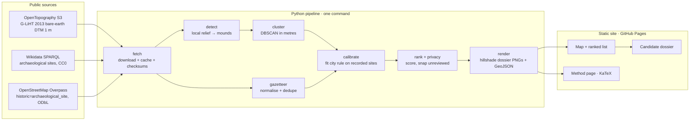

# Hidden Cities — System Design

Hidden Cities ranks places in NASA's 2013 G-LiHT lidar strips over Campeche, Mexico, where ancient Maya structures cluster densely but no recorded site appears in the open site lists. The output is a static, interactive map. Each candidate opens a dossier with its lidar picture and numbers.

The ranking is a **to-check list, not a list of discoveries**. Open site lists (Wikidata, OpenStreetMap) are sparse, so many candidates are probably already known to archaeologists.

## Architecture

## Components

| Piece | Job | Interface |
|---|---|---|
| `pipeline/fetch.py` | Lists and downloads DTM tiles from the public OpenTopography bucket, and fetches site lists. Caches everything under `data/raw/` (git-ignored) and records each source URL, its size and its date in `data/manifest.json`. | `fetch_tiles(keys) → paths`, `fetch_sites(bbox) → raw json` |
| `pipeline/gazetteer.py` | Turns Wikidata and OSM records into `{id, name, lon, lat, source, url}`. Points within 500 m of each other are merged. | `load_sites() → list[Site]` |
| `pipeline/detect.py` | Builds a local relief model and finds mound-like blobs. Pure NumPy: the input is an array and its pixel size, the output is a list of blobs. | `detect(dtm, res) → list[Structure]` |
| `pipeline/cluster.py` | Groups structures with DBSCAN in projected metres (UTM 15N). | `cluster(structs, eps, min_n) → list[Cluster]` |
| `pipeline/calibrate.py` | Grid-searches the city rule `(eps, N, H)`. Keeps rules that catch ≥ 90 % of recorded sites inside the strips, then picks the one that yields the fewest candidates per 100 km². | `calibrate(clusters, sites, footprint) → Rule` |
| `pipeline/rank.py` | Applies the rule and drops clusters within 2 km of a recorded site. Ranks the rest by structure count, then by tallest mound. Applies coordinate privacy. | `rank(...) → list[Candidate]` |
| `pipeline/render.py` | Writes `site/data/*.geojson`, `site/data/summary.json` and one hillshade PNG per candidate and per matched recorded site. | files |
| `pipeline/run.py` | Runs everything in order with a single command. | `uv run python -m pipeline.run` |
| `site/` | A static HTML/CSS/JS page with MapLibre GL and KaTeX, both pinned on a CDN. No build step and no server. | reads `site/data/` |

## Main flows

1. **Regenerate.** `uv run python -m pipeline.run` fetches (or reuses the cache), detects, clusters, calibrates, ranks and renders. It is deterministic: no randomness, inputs are pinned by key and size, and library versions are pinned in `pyproject.toml` and `uv.lock`.
2. **Browse.** The site opens on the map. The ranked list sits at the side. Clicking a candidate opens its dossier: the lidar picture, structure count, tallest mound, distance to the nearest recorded site, and why it ranks where it does.
3. **Review.** When an archaeologist has looked at a candidate, Amal adds it to `data/reviews.json`. On the next run that candidate shows exact coordinates.

## Data

- **Lidar.** G-LiHT 2013 transects, reprocessed to bare earth by Britton (OpenTopography DOIs 10.5069/G9Z899N1 and 10.5069/G9TH8JX9; CC BY 4.0 per OpenTopography; PDDL copy on Scholar@UC). We use the 1 m DTM. The full West set is 222 files, 1.8 GB. v1 uses 20 segments (57.8 km², ~170 MB): the tiles whose boxes contain one of the 4 listed sites, plus 2 neighbours either side on the same flight line. Measured strip width is ~390 m.
- **Recorded sites.** Wikidata (CC0) and OpenStreetMap (ODbL), fetched on 2026-11-11 for the box 94.5°W–86.5°W, 16°N–21.8°N. Fetched counts: 689 Wikidata items, using subclasses of Q839954 such as "Maya site", and 349 OSM features. "Unrecorded" means **not in these open lists**.
- **Where data lives.** Raw downloads are in `data/raw/`, which is git-ignored and re-downloadable. Generated outputs that the site needs are small (tens of MB) and committed in `site/data/`. There is no database: the volumes are tiny and every output is a pure function of its inputs.

## Key decisions and trade-offs

| Decision | Why | Cost |
|---|---|---|
| Our own rule-based detector, not ML | Britton's catalog isn't public and his model needs ArcGIS. Rules are explainable and free. | Probably less accurate. Thresholds are invented starting values, tuned on the test area and labelled as such. |
| Thresholds fitted on recorded sites | Avoids made-up numbers. The rule is defined by the recall it achieves. | Few recorded sites lie inside thin strips, so the fit rests on a small n. The UI reports that n. |
| Narrow strips (~390 m, measured) | That's the data. | We see slices of settlements, so "N structures within ε" counts only the part inside the strip. Candidates are dense slices, not whole cities. |
| Static site, no server | $0, nothing to attack, works offline once loaded. | No live re-analysis in the browser. |
| Unreviewed candidates snapped to a 0.1° (~11 km) grid cell | Looting risk (decided by Amal, round 2). | Others can't check them without asking. The dossier image could still be matched against the public lidar by a determined person; that residual risk was put to Amal and accepted (see below). |
| OpenFreeMap light/dark vector basemap | No key or sign-up, light and dark styles, attribution shown. (CARTO was tried first; its tiles now answer "API key required".) | Third-party tile requests reveal viewers' IPs to OpenFreeMap. This is stated in Settings. |

## Threat model (privacy and security)

- **Assets.** The precise locations of unreviewed candidate sites, which looters would want. There is no user data: no accounts, forms, cookies or analytics.
- **Who could misuse what.**
  - A looter reads `site/data` → unreviewed candidates hold only the grid-cell centre, and exact points are never written to `site/`. A test asserts this.
  - A looter matches a dossier image against the public lidar → possible, since the source data is public anyway. The marginal help we give is the ~11 km cell. Accepted residual risk: Amal chose to publish the top-40 pictures as is (2026-11-11), over hiding strips inside cells or dropping candidate pictures.
  - A tampered data file causes XSS → all text from Wikidata/OSM is inserted with `textContent`, never `innerHTML`, and site names are escaped.
  - A supply-chain attack via the CDN → only pinned versions are used, with Subresource Integrity hashes.
- **Viewer privacy.** The theme and layer choices are kept in `localStorage` on the viewer's own device. The only third-party requests are basemap tiles (OpenFreeMap) and the CDN for libraries. The feedback link opens a GitHub issue form, and nothing is sent automatically.
- **Secrets.** None are needed. All sources are public with no keys.

## Testing

- **Unit tests on synthetic DTMs** (`tests/`):
  - Normal case: flat ground with planted mounds of known size and height. Each is found once, and the area and height come out within 10 %.
  - Edge cases: mounds at the tile edge, a sloped hill (it must not count as a mound), nodata holes, a single-pixel spike (noise, must be rejected), and an empty tile.
  - Failure cases: all nodata, the wrong CRS, a missing file. Each must give a clear error.
- **Cluster and calibration tests** on planted point sets with a known answer.
- **A privacy test**: no unreviewed candidate in `site/data` carries exact coordinates.
- **An end-to-end test**: running the pipeline on a synthetic fixture area produces valid GeoJSON and a summary.
- **A browser check**: load the site and click a candidate in light and dark mode, with no console errors.

## Scale — now and later

- **Now:** a few transects, tens of MB, one laptop, processing in seconds to minutes.
- **All 456 West + East transects (~3.7 GB):** still one laptop. The pipeline processes one tile at a time with a bounded memory footprint, so this works as is (minutes to an hour).
- **Other lidar (Middle Usumacinta, Belize) or national-scale DTMs:** swap the source in `fetch.py` (each source sits behind its own function). Above ~100 GB, move to cloud-optimized reads (COG range requests) and parallelize per tile.
- **More than ~10k candidates on the map:** switch the GeoJSON to vector tiles (PMTiles).

## Build outline and the next ten steps

1. Pipeline core with synthetic tests (detect, cluster, calibrate, rank).
2. Fetch the test area and the site lists, and record the manifest.
3. Run on real data. Measure the strip width. Look at the hillshades of matched recorded sites to sanity-check the detector by eye.
4. Calibrate the city rule and report recall, its n, and candidates per 100 km².
5. Render the dossiers and GeoJSON.
6. Build the site: map, list, dossier, method page, settings, feedback, opening animation.
7. Browser checks in light and dark mode.
8. Docs and README. Publish to GitHub Pages.
9. *(Later)* If Britton's catalog arrives, swap it in for `detect` and compare.
10. *(Later)* Scale to all transects, then add other lidar areas and an ML detector.

Rework risks:
- If the detector proves useless on real data (for example, it fires on everything in karst terrain), steps 4–6 are blocked. Step 3 is the gate.
- If too few recorded sites fall inside the strips, the calibration can't work. The fallback is a ranked list with no cut-off, clearly labelled.

## Known limits

- **v1 result: the calibration couldn't run.** All 4 listed sites near the test strips lie 190–540 m outside them, so 0 are eligible and the pipeline used the labelled fallback (loosest rule, ranking with no cut-off). Fixing this needs ground truth inside the strips (see the next ten steps).
- Pictures are drawn for the top 40 candidates only (`DOSSIER_TOP`), keeping the site to ~10 MB.

- The open site lists are sparse, so "unrecorded" is weak.
- A strip shows only a slice of a settlement.
- The detector's thresholds are invented starting values.
- Natural features produce false positives. In the by-eye audit of the top 16, about half were stream banks, gullies or hills, and a river meander ranks #1. Strip edges made false mounds until the 75 m edge buffer was added.
- Nothing has been checked on the ground.
